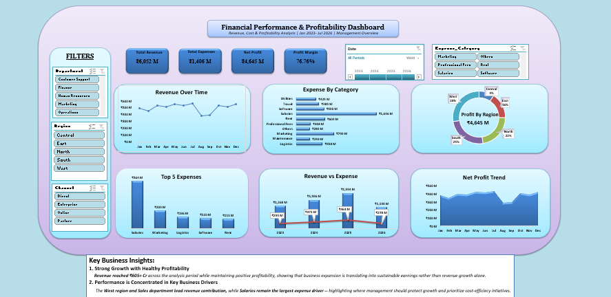
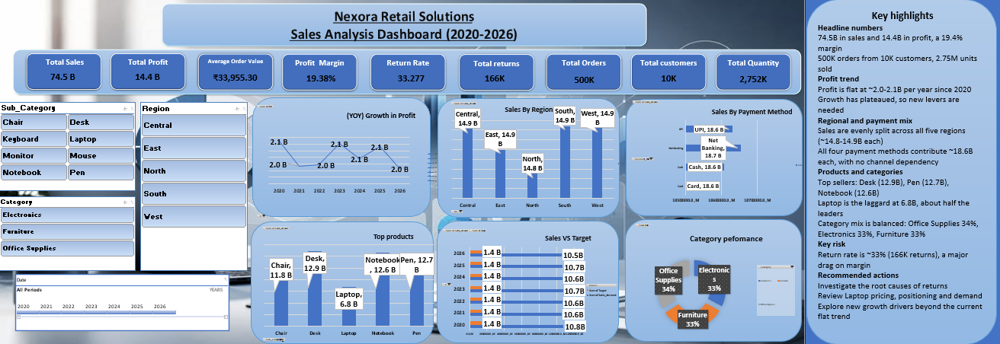
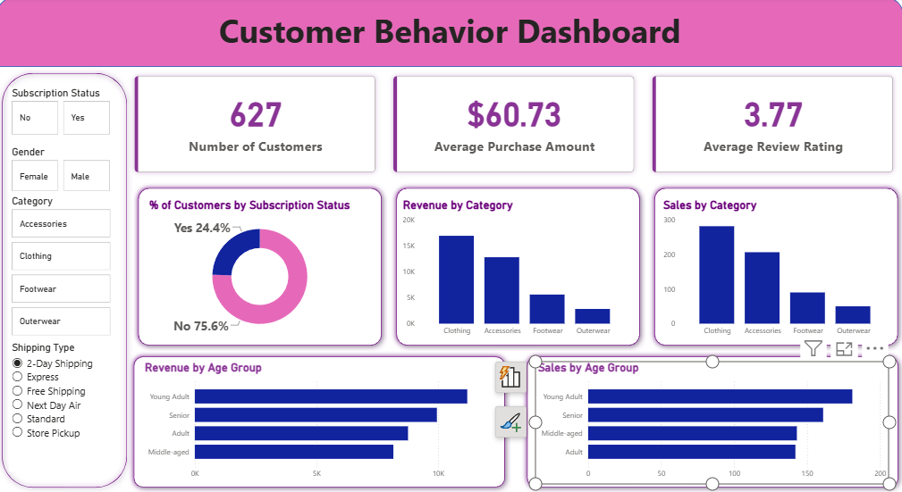
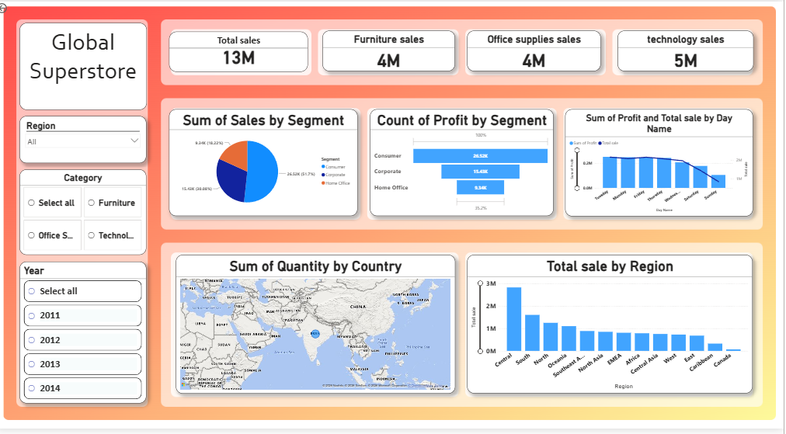
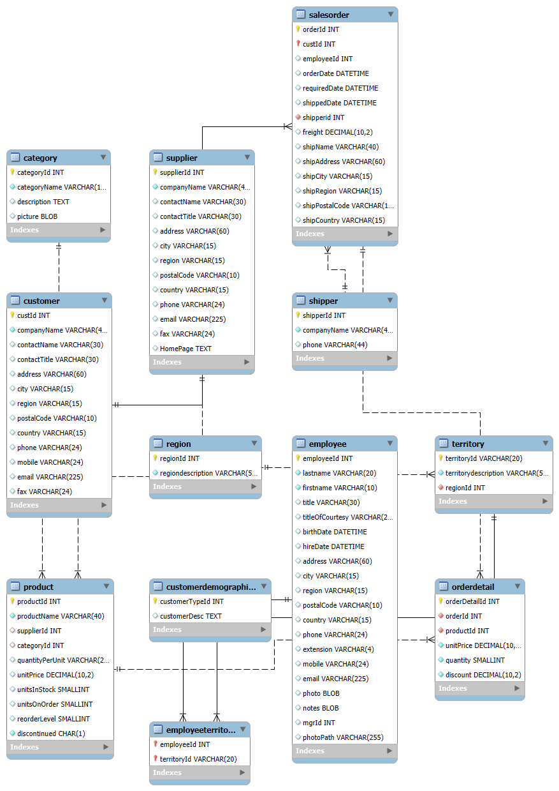

<h1 align="center">Hi, I'm Garima Rajput 👋</h1>

  <b>Aspiring Data Analyst</b> | Turning raw data into clear, actionable insights 📊

  
  

---

## 👩‍💻 About Me

I'm a fresher data analyst who enjoys finding the story behind the numbers. I build end-to-end projects on real-world datasets, covering data cleaning, exploratory analysis, SQL querying, and dashboard reporting, with a focus on answering real business questions.

## 🛠️ Tech Stack

**Techniques:** Data Cleaning • Exploratory Data Analysis (EDA) • Joins & Window Functions • Power Query • Power Pivot • Dashboard Design

## 🚀 Featured Projects

## 💰 Financial Performance & Profitability Dashboard

**Advanced Excel • Pivot Tables • KPI Design**

Interactive dashboard analyzing company financial performance:

- Revenue, cost, and profit analysis
- Profitability trends and comparisons
- Executive KPI summary
- Business insight extraction

## 📊 Nexora Retail Solutions Sales Dashboard

**Excel • Power Query • Power Pivot**

Data cleaning and modeling for sales analysis:

- Data cleaning with Power Query Editor
- Data modeling with Power Pivot
- Interactive sales dashboard

## 🧠 Customer Behaviour Analysis

**Python • SQL • Power BI**

End-to-end analytics lifecycle:

- Data retrieval with SQL
- Exploratory data analysis in Python
- Interactive Power BI report
- Business insight extraction

## 📊 Global Superstore Sales Dashboard

**Power BI • DAX • Data Modeling**

Interactive sales analysis dashboard built in Power BI:

- Data cleaning and transformation with Power Query
- Data modeling and KPI measures with DAX
- Interactive dashboard with Region, Category, and Year slicers

)

### 🔑 Key Insights

- **Total sales: 13M**, split across Technology (5M), Furniture (4M), and Office Supplies (4M)
- **Consumer** is the largest segment (51.7% of sales), followed by Corporate (30.1%) and Home Office (18.2%)
- **Central** is the top-performing region by total sales, while **Canada** is the lowest
- Sales and profit are tracked by day of the week to spot weekly trends

### 📈 Dashboard Features

- **KPI cards:** Total, Furniture, Office Supplies, and Technology sales
- **Pie chart:** Sum of Sales by Segment
- **Funnel chart:** Count of Profit by Segment
- **Combo chart:** Sum of Profit and Total Sales by Day Name
- **Map:** Sum of Quantity by Country
- **Bar chart:** Total Sales by Region
- **Slicers:** Region, Category, and Year (2011–2014)

### 🛠️ Tools Used

- Power BI Desktop
- Power Query Editor
- DAX

## 🛒 Retail Sales Analysis

**MySQL • Joins • Window Functions**

Business questions answered with SQL:

- Multi-table joins to combine sales data
- Window functions for rankings and running totals
- Insights on products, customers, and revenue

## 📚 Currently Learning

- 📈 Statistics for data analysis
- 📊 Data visualization with Matplotlib
- 🤖 Machine learning fundamentals

## 🤝 Let's Connect

I'm open to **data analyst opportunities and internships**. Feel free to reach out on [LinkedIn](https://www.linkedin.com/in/garima-rajput-047b61346) or by [email](mailto:garimarajputapril@gmail.com).

<i>"Without data, you're just another person with an opinion."</i>

